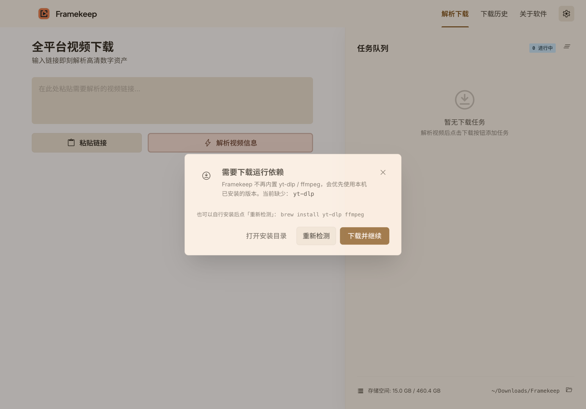

# Framekeep

An open-source desktop app for saving video, audio and subtitles on macOS, Windows and Linux.

[简体中文](README.zh-CN.md) · [Download](https://github.com/oiov/download/releases) · [Report an issue](https://github.com/oiov/download/issues)



## Features

- Parse video links and choose available quality and formats.
- Save audio and subtitles; manage download queues and local files.
- Configure yt-dlp and FFmpeg or reuse compatible system installations.
- Chinese and English interface, with updates from this repository.

Save only content you own or have permission to download.

## Install

Choose a package matching your system and processor from Releases. macOS has Apple silicon and Intel builds; Windows uses x64; Linux packages are labeled by architecture and format.

Follow runtime setup on first launch. Some YouTube sources also require Node.js or Deno. Current installers are not signed or notarized; your operating system may show a security prompt.

## Develop

Requires Node.js 22+, pnpm and Go 1.24+.

```sh
pnpm install
pnpm dev
pnpm test
pnpm build
```

See [AGENTS.md](AGENTS.md) for conventions and validation.

## Website

```sh
node scripts/build-website.mjs
node scripts/serve-website.mjs
```

Open http://localhost:4179. See [Cloudflare deployment](docs/website-deployment.md).

## License and credits

[MIT](LICENSE). Based on [DownVid](https://github.com/yxxbc/downvid) by yxxbc and [Videdown](https://github.com/cshuangyy/videdown) by cshuangyy. Original copyright notices are retained. yt-dlp and FFmpeg are subject to their respective licenses.
